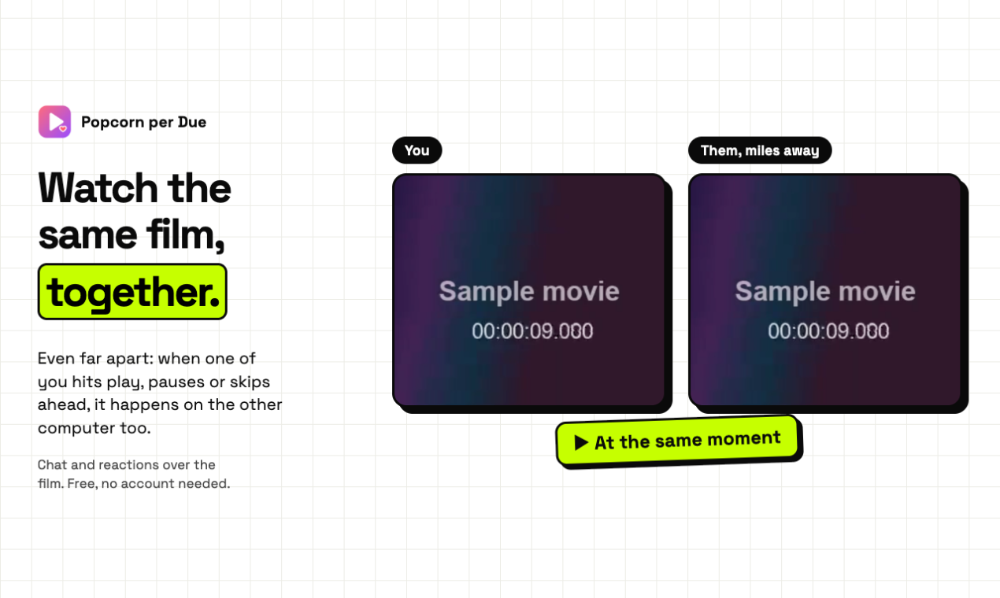

<h1 align="center">Popcorn per Due</h1>

Guarda un film insieme a chi è lontano, nello stesso momento. Gratis.

  <a href="https://chromewebstore.google.com/detail/choolchdfdpggmcdmdnhlcnkmbbinlcl"><b>Aggiungilo al browser</b></a> ·
  <a href="https://ia-lab.site/popcorn-per-due/">Il sito</a> ·
  <a href="https://chromewebstore.google.com/detail/choolchdfdpggmcdmdnhlcnkmbbinlcl/reviews">Lascia una recensione</a>

Un'estensione per Chrome e Brave. Uno preme play, mette in pausa o va avanti, e succede lo stesso anche dall'altra
parte. Sopra il film ci sono chat, reazioni e videochiamata. Funziona su Netflix, Prime Video, Disney+ e YouTube.

Non servono account e non c'è pubblicità. L'abbiamo fatta in [IA-Lab](https://ia-lab.site), un laboratorio no profit
sull'intelligenza artificiale.

**Il codice qui non c'è**, perché non vogliamo che qualcuno lo prenda e lo rivenda. Questa pagina serve per le idee e
le segnalazioni, e se ti è piaciuta puoi lasciare una stella in alto a destra.

Qualcosa non va? Dall'estensione: icona → «segnala un problema». Oppure apri una
[issue](../../issues). Privacy: [ia-lab.site/popcorn-per-due/privacy](https://ia-lab.site/popcorn-per-due/privacy).
Condizioni d'uso: [licenza](LICENZA.md).

© 2026 Leonardo Alucci, tutti i diritti riservati.

---

**In English.** A free Chrome and Brave extension to watch a film in sync with someone far away: play, pause and
seek happen on both sides, with chat, reactions and video calls on top. Works on Netflix, Prime Video, Disney+ and
YouTube. No account needed, no ads. Made at [IA-Lab](https://ia-lab.site), a non-profit lab. The source code isn't
public because we don't want it resold. [Add it to your browser](https://chromewebstore.google.com/detail/choolchdfdpggmcdmdnhlcnkmbbinlcl),
and if you like it, a star helps.
